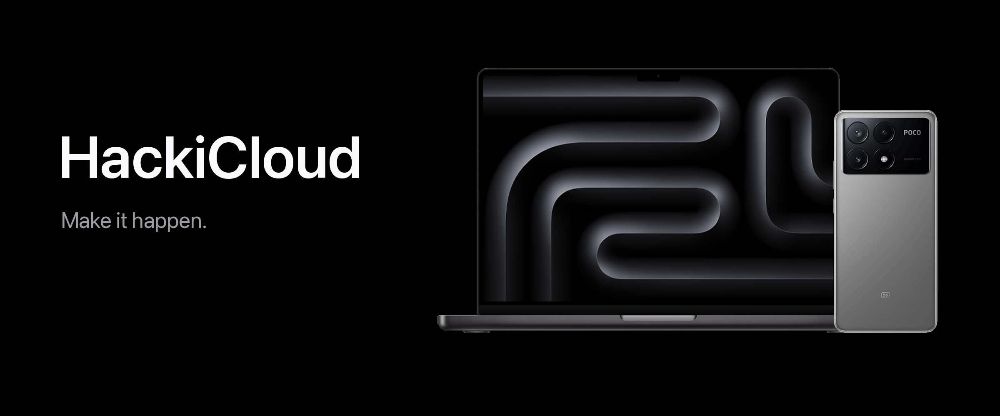

# HackiCloud

A local USB bridge that lets a compatible HakiOS port use its owner's Mac for native iCloud authentication from Settings. Includes an optional anonymous App Store **catalog** helper.

The Settings sign-in path has worked on the development device. The packaged Mac client has now connected to both installed bridge channels and passed the phone's native AuthKit check. The optional catalog command has returned HTTP 200 from the phone, preserving a valid token across a reboot. See [what was actually tested](docs/VALIDATION.md).

**This is a development release for compatible HakiOS ports.** It is not an installer for ordinary Android, a jailbreak, or a general iCloud implementation. A fresh installation of the newly named device modules has not yet been tested end to end; the validated migration mode reuses the existing working HakiOS modules.

## Requirements

- Your own Mac, macOS 13 or later, Python 3.9 or later, and a data-capable USB connection. Native execution was tested on Intel with macOS 26.6; Apple Silicon binaries were compiled and verified, but not run on Apple Silicon hardware.
- A HakiOS device already booting iOS, with the rootless `/var/jb` environment, its USB command service on port 19802, a compatible host USB multiplexer, and the `kern.exec_inject` mechanism. An ordinary iPhone or Android phone does not provide these interfaces.
- Working native Apple authentication on the Mac. The bridge uses private macOS interfaces, so compatibility must be checked on each system.
- For source builds: Xcode or Apple's command line tools. Device compilation additionally requires an iPhoneOS SDK obtained through Xcode. No SDK, Apple framework or firmware is included.

The local packaged ZIP includes the project's own compiled helpers. A checkout from GitHub must be built first. Full [Spanish setup and requirements](docs/REQUISITOS.md) are provided.

## Build and check

```sh
./hackicloud.sh build --ios-sdk "$(xcrun --sdk iphoneos --show-sdk-path)"
./hackicloud.sh doctor --native-check
```

`doctor --native-check` obtains anonymous validation data and signs a synthetic fixture on the Mac. It does not read your password or initiate account login.

## Prepare an iOS boot image with the USB command service

```sh
# Source checkout: build the Mac and device helpers first.
./hackicloud.sh build --ios-sdk "$(xcrun --sdk iphoneos --show-sdk-path)"
# lz4 must be on PATH (Homebrew supports both /usr/local and /opt/homebrew).
brew install lz4
./hackicloud.sh patch-boot --image "/path/to/boot.img"
# Omit --image to select the image with a macOS file picker.
./hackicloud.sh patch-boot
```

Supply the **port-generated image that already boots iOS**, not a stock Android boot image or an IPSW. The current adapter supports the Poco X6 Pro HakiOS boot-v4/legacy-LZ4 layout with its embedded `redwood` APFS bootstrap. Its kernel must already implement `/dev/hakios-usbmux`, and its loader must enable `usb=2`. Other layouts and signed/AVB images are rejected with an explanation; this cannot add a missing hardware USB driver to an arbitrary kernel.

The command writes a **new** `*-HackiCloud-USB.img` and a JSON checksum report. It adds the device USB daemon and its watchdog, updates their startup job, rebuilds and re-reads the bootstrap, and verifies file contents, ownership and permissions. It preserves the XNU kernel, first embedded disk, external-volume extent tables and Android fallback image. It does not flash, choose a boot slot, erase data or modify the input. Install the candidate using your port's established recovery procedure.

This is our **USBMux command bridge**, comparable to the development access provided by ADB; it does not install Android's ADB protocol. It exposes local development commands to the physically connected host, so use it on your own development device.

After booting the prepared image, start the host bridge in a separate terminal:

```sh
./hackicloud.sh usb-host
```

Leave it running, then use `doctor`, `install` and `run` in another terminal. HackiCloud automatically selects its private USB socket when present. It does not replace Apple's `/var/run/usbmuxd` or require disabling Apple's daemon. If your port already works through the system multiplexer, you can keep using it or explicitly select `--mux-socket /var/run/usbmuxd` before the command.

All four Mac helpers, including the USB bridge, are built as **universal `x86_64` + `arm64`** binaries. Python and the image patcher do not depend on Intel paths or Rosetta. Apple Silicon compilation and signatures have been checked; physical Apple Silicon USB/sign-in testing is still pending. See [boot image details](docs/BOOT-USB.md).

## Use the existing HakiOS bridge

This is the mode validated on the development phone. Stop the previous Mac provider before running this client; two providers must not compete for the same channels.

```sh
./hackicloud.sh install --reuse-existing
./hackicloud.sh run --reuse-existing
```

It preserves the installed device hooks and uses their existing owner-local permissions. Keep the process running, open Settings yourself, and enter your credentials and verification codes **only on the phone**. Do not put credentials in a terminal or send them to this project.

Both `Validación: conectado por USB` and `Firma de Ajustes: conectado por USB` should appear. They prove channel connectivity; they do not, by themselves, prove that Apple accepted a login. The original development setup has separately completed Settings sign-in.

## New installation on a compatible port

```sh
./hackicloud.sh install --dry-run
./hackicloud.sh install --restart-auth
./hackicloud.sh run
```

This adds two project-owned injection entries, private temporary permission files and three helper files under `/var/jb/usr/bin`. It refuses conflicting existing hooks rather than replacing them. `--restart-auth` relaunches the authentication daemon; close and reopen Settings manually afterward. This installation path remains experimental until it is tested on a clean compatible port.

## Optional App Store catalog

```sh
./hackicloud.sh enable-catalog --storefront us
```

Use your desired two-letter catalog region, such as `us`, `es` or `ve`. This controls the catalog query, not the country of an Apple Account.

The command preserves an existing valid native catalog token. If the cache slot is empty, it asks the Mac's native AppleMediaServices framework for an anonymous token using isolated keychain callbacks, transfers it over the authenticated local USB channel, checks it against Apple's catalog, and stores it in the phone's native anonymous catalog cache. Token values are never printed or saved to files by the Mac client.

It then queries the catalog from the phone and reports the server's actual expiration date. The original development token lasted approximately a month and survived a reboot. This duration is not guaranteed. An existing unusable entry is left unchanged; automatic replacement and renewal are not implemented in this release.

**Catalog access does not establish an App Store account or enable downloads.** Account authentication, purchases, downloads, FairPlay and ongoing experimental Store work are outside this release. If the Store was showing a connection error, retry its page manually after the catalog check passes.

## Privacy and limits

- Providers listen through the phone's loopback interface and are accessed over USB. No public relay or remote authentication service is used.
- Account request bodies needed for the Settings signature are processed in the owner's Mac memory. Application code does not persist their contents, signatures, passwords or verification codes. Core dumps are disabled in the provider processes.
- The client's private local state contains only a random channel nonce and version. The native iOS account store and anonymous catalog cache retain their normal data.
- Permissions expire and are renewed while the client runs. Stopping with Ctrl+C preserves accounts and stops the Mac provider. A working clock is required; startup synchronizes the phone to the Mac if they differ by more than 30 seconds.
- This does not promise iCloud Keychain, Passwords, push notifications, iMessage, Maps or every iCloud service. Password synchronization remains unresolved.
- No Apple binaries, device identities, personal account data or credentials are distributed. Calling native APIs does not imply Apple approval or endorsement.

```sh
./hackicloud.sh status
./hackicloud.sh uninstall
```

Uninstall removes only the new project's injection entries and permissions. It does not delete accounts or the existing bridge used by migration mode. A process that already loaded a module retains it until that process exits.

## Development

```sh
python3 -m unittest discover -s tests
```

Tests cover USB framing and selection, private state, request validation and replay rejection, device-side bounds, lease handling, injection ownership and catalog metadata. Native C checks require Clang; no Apple Account is needed for unit tests.

Source code is MIT licensed. Manufacturer images and trademarks are excluded from that grant; see [NOTICE](NOTICE) and [image attribution](assets/image-sources.json).
